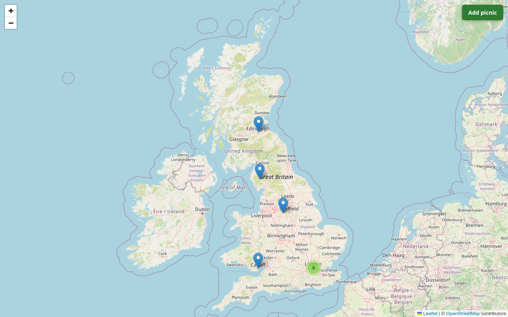
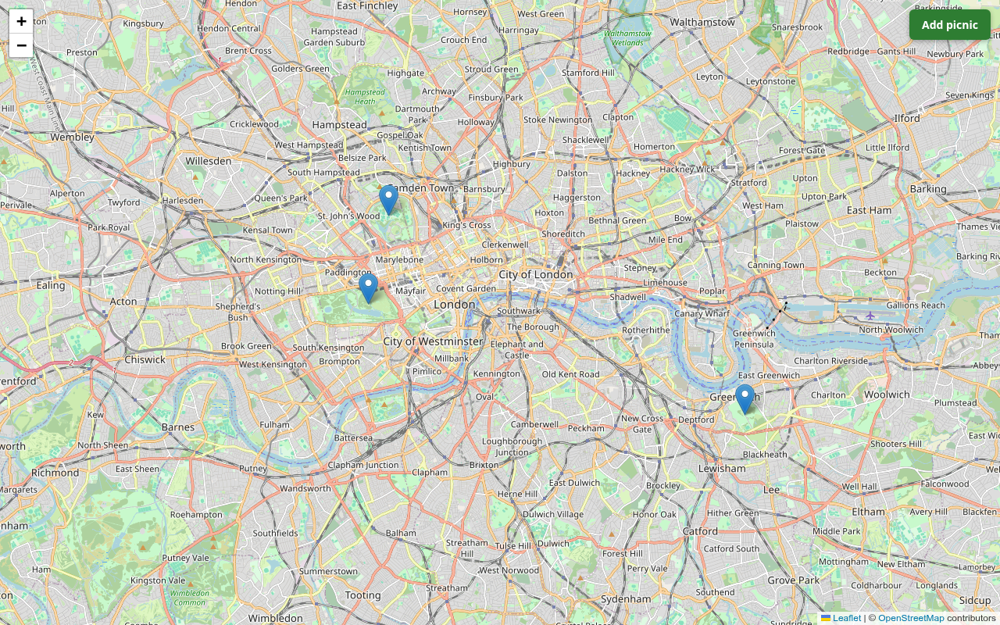
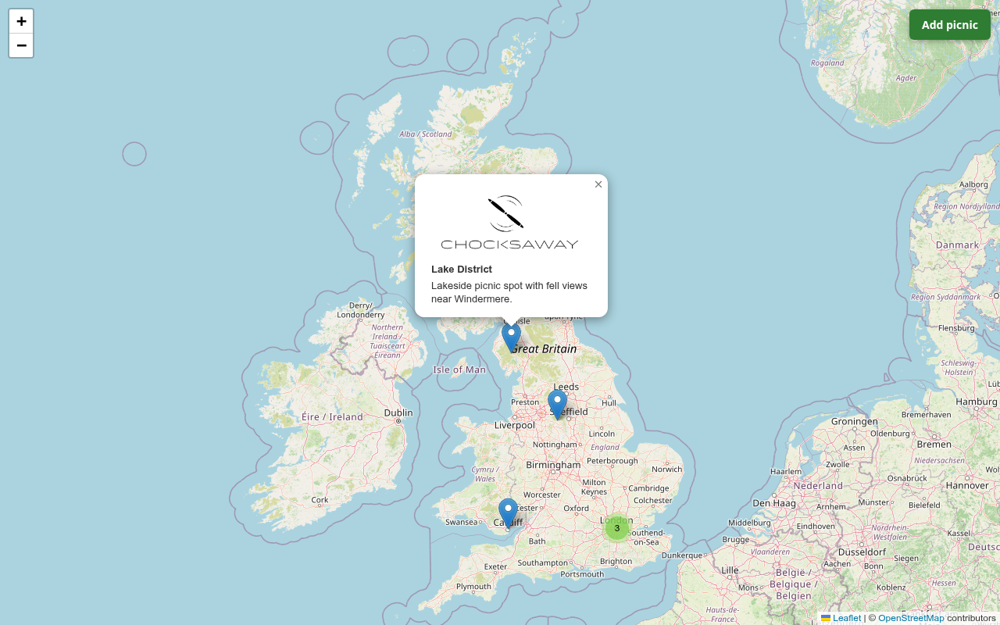
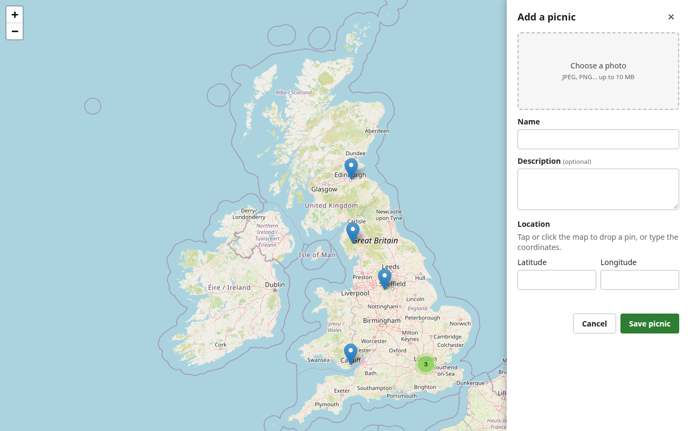

# MyPicnicPlace

A place to catalogue your favourite picnic spots.  Drop a pin on a map, give the spot a name, a description and a photo, and see all your spots on a map of the UK.

The project is in two parts:

- **MyPicnicPlace** (this repo): a Spring Boot REST API that stores picnic sites and photos.
- **MyPicnicPlaceFrontend** (`../MyPicnicPlaceFrontend`): a Vite + TypeScript map built with Leaflet.

## What it looks like

The map opens on the UK.  Spots that are close together are grouped into a numbered cluster.



Click a cluster to zoom in and split it into individual pins.  Here the cluster of 3 around London has opened into Regent's Park, Hyde Park and Greenwich Park.



Click a pin to see its photo, name and description.  On a device with a mouse, hovering over a pin shows just the photo.  A spot with no photo gets a placeholder image.



**Add picnic** opens a panel.  Choose a photo, enter a name and optional description, then click the map to drop a pin, or type the latitude and longitude.



## How it works

```
Browser (Leaflet)  ──/api, /uploads──►  Spring Boot  ──►  Redis        (picnic sites, image metadata)
                                                     └──►  uploads/     (photo files on disk)
```

- Saving a picnic with a photo is two calls: the photo is uploaded first (`POST /api/upload`), then the picnic is created with the returned filename (`POST /api/picnics`).
- Uploaded files are renamed to a random UUID, so two uploads can't collide and filenames can't be used for path traversal.
- The API returns a ready-to-use `photoUrl` for each picnic, and never exposes the stored record directly.
- Latitude and longitude are required and validated (-90 to 90 and -180 to 180).  Negative longitudes are fine, so London works.

### API

| Method | Path | Does | Responses |
|---|---|---|---|
| `GET` | `/api/picnics` | List all picnic sites | 200 |
| `GET` | `/api/picnics/{id}` | Get one picnic site | 200, 404 |
| `POST` | `/api/picnics` | Create a picnic site (JSON body: `name`, `lat`, `lon`, `description`, `photoFilename`) | 201 with `Location`, 400 |
| `POST` | `/api/upload` | Upload an image (multipart field `file`, `image/*` only, 10 MB max) | 200, 400, 415, 500 |
| `GET` | `/uploads/{filename}` | Download an uploaded image | 200, 404 |

## Running it

You need Java 21, Docker or a local Redis, and Node for the frontend.

**1. Redis** on `localhost:6379`:

```bash
docker run -d --name picnic-redis -p 127.0.0.1:6379:6379 redis:7
```

**2. Backend**, from this folder:

```bash
./mvnw spring-boot:run
```

It listens on `127.0.0.1:8080` only.

**3. Frontend**, from `../MyPicnicPlaceFrontend`:

```bash
npm install
npm run dev        # http://localhost:5173
npm run seed       # optional: adds 7 sample picnics (skips names that already exist)
```

Vite forwards `/api` and `/uploads` to the backend, so the backend needs no CORS configuration.  To open the map from another device on your network, use `npm run dev:lan`.

## Tests

```bash
./mvnw test        # unit tests, no Docker or Redis needed
./mvnw verify      # unit tests plus *IT integration tests (needs Docker, starts a Redis container)
```

## Project layout

```
src/main/java/com/chocksaway/picnic/
  controller/   PicnicController, ImageUploadController
  service/      FileSystemStorageService     stores photos on disk
  repository/   PicnicRepository             Redis, atomic MULTI/EXEC writes
  image/        ImageMetadata, ImageMetadataRepository
  model/ dto/   domain classes and request/response types
  config/       RedisConfig, WebConfig
```

## Configuration

`src/main/resources/application.properties`:

| Property | Default | Meaning |
|---|---|---|
| `upload.dir` | `uploads` | Where photos are stored |
| `spring.servlet.multipart.max-file-size` | `10MB` | Largest upload |
| `spring.data.redis.host` / `port` | `localhost` / `6379` | Redis connection |
| `server.address` | `127.0.0.1` | The backend only accepts local connections |

## System map

`tools/graph/` has a small extractor that reads the Java source and generates a set of linked Markdown notes (an Obsidian vault) mapping each endpoint through its controller, service and repository to Redis or the filesystem.  See `tools/graph/README.md`.
